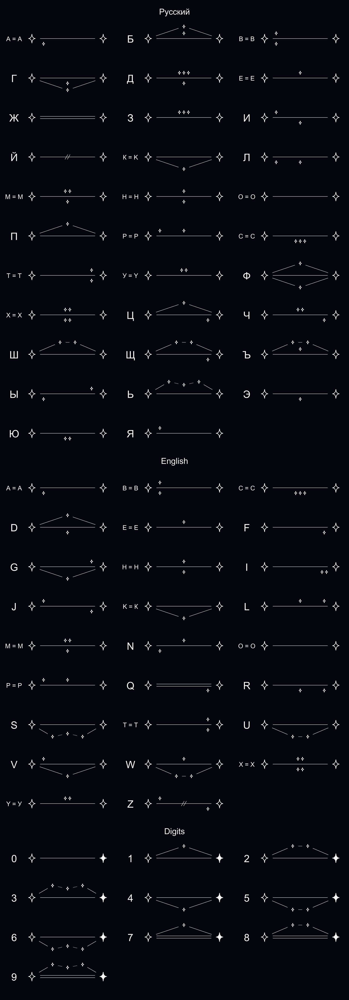

# Astro Cipher

Hide text in a picture of the night sky. Every letter is a line between two big stars; small stars,
roofs and other little marks around the line tell the letters apart. Words are chains of stars, numbered
with Roman numerals. To anyone without the key, it's just a constellation.



- **Russian, English and digits.** Russian and English look-alikes (А/A, В/B, Е/E, ...) share one picture.
- **Digits** end in a solid star: `0` = bare line, `1`-`3` = roof of 1-3 stars above, `4`-`6` = 1-3 below,
  `7`-`9` = roof above on a double line.
- **Every picture is different:** line lengths, turns, roof heights and spacing are random; `--seed` repeats one.
- **Decoder reads the pixels** of a JPG, PNG or SVG made by the encoder: it finds the stars, lines and
  numerals and walks each word from its numbered star.
- Anything that isn't a letter or digit counts as a space.

The full rules, with a table for every symbol, are in [RULES.md](RULES.md).

## Usage

```bash
pip install -r requirements.txt

./astrocipher encode "i invented a cipher"       # -> <sha256 of the picture>.jpg, with a progress bar
./astrocipher encode "Лагерь Маши" --svg         # -> <sha256>.svg (vector image)
./astrocipher encode "Лагерь Маши" -o lager.jpg  # -> exactly that file name
./astrocipher decode lager.jpg -v                # prints the text; -v shows what was read per letter
./astrocipher alphabet                           # re-renders alphabet/ and RULES.md after editing alphabet.py
```

Files are named by the SHA-256 of their own bytes, so a file name never gives the message away.
The fonts used for numerals and the key sheet are macOS system fonts (Times New Roman, Arial Unicode).

## Files

| File | What it does |
|---|---|
| `alphabet.py` | the cipher's rules: which marks make up every symbol |
| `encode.py` | random constellation layout and drawing (JPG or SVG) |
| `decode.py` | reads a picture back into text |
| `cli.py`, `astrocipher` | the `astrocipher` command |
| `make_alphabet.py` | renders `alphabet/` (one picture per symbol, key sheet) and `RULES.md` |
| `ideas/` | design mock-ups explored for the digit symbols |

## Tests

```bash
python test_roundtrip.py   # sample sentences, SVG + JPG
python test_angles.py      # every symbol alone at 24 angles with random shapes
python test_stress.py      # many random layouts, with timing
```

## License

MIT, see [LICENSE](LICENSE).

AI friendly: built together with Claude.
